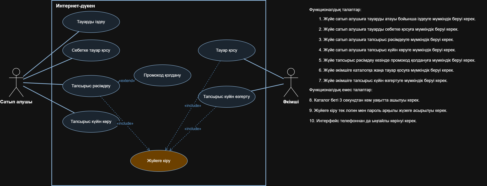
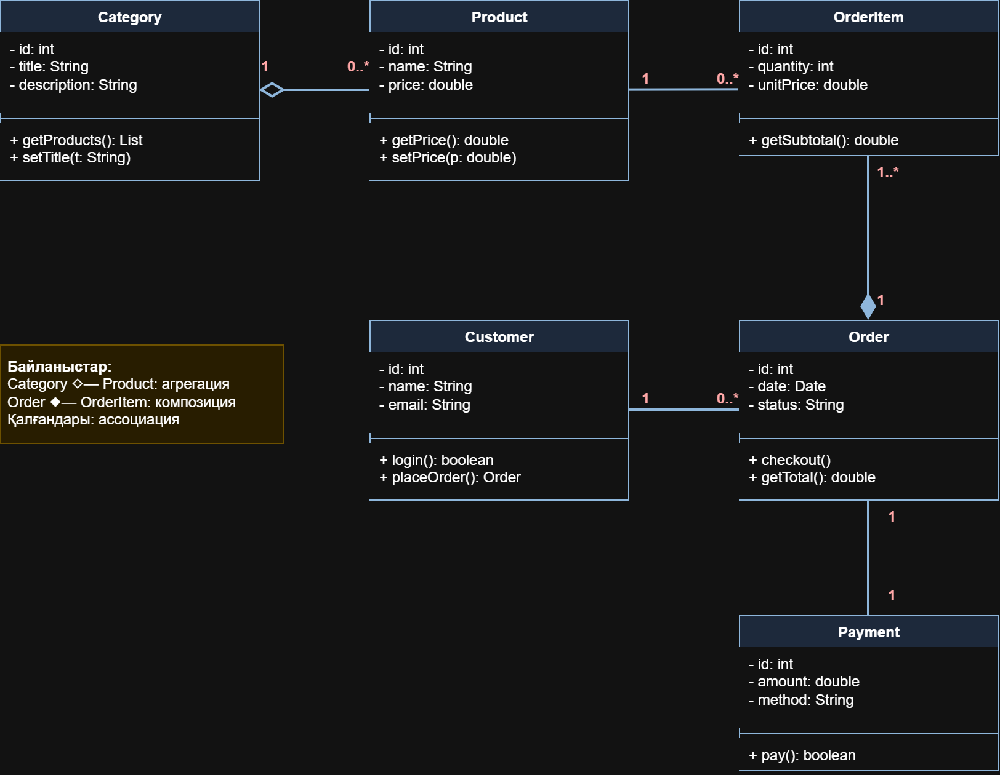
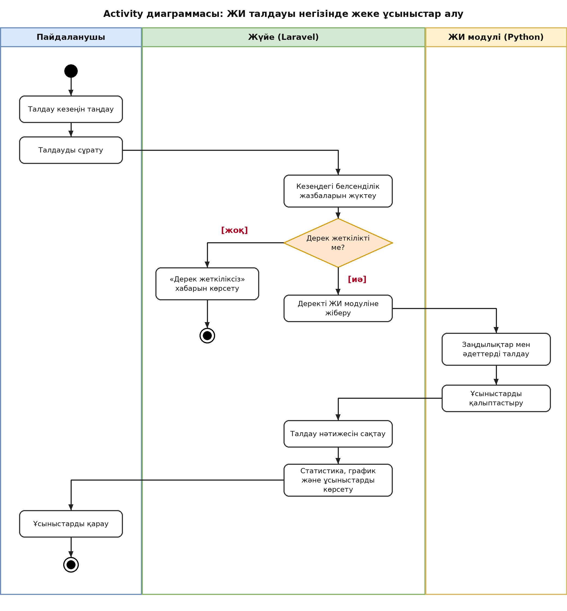

# ActivityMind

Автор: [Аты Тегі], [топ]

Өнімділікті талдауға арналған веб-қосымша.

## Мәселе
Адамдар уақытын неге жұмсайтынын көбіне түсінбейді және өнімділікке кедергі келтіретін әдеттерін байқамайды. ActivityMind пайдаланушының белсенділігін жинап, статистика мен графиктерді көрсетеді, әдеттер мен тапсырмаларды қадағалайды, ал жасанды интеллект талдауы негізінде жеке ұсыныстар береді. Қосымша студенттерге, фрилансерлерге және уақытын тиімді басқарғысы келетін барлық адамға керек.

## Акторлар
- Пайдаланушы
- Жүйе (Laravel веб-қосымшасы)
- ЖИ талдау модулі (Python)

## Технологиялар
Laravel, PHP, MySQL, JavaScript, Python

## Талаптар
### Функционалдық
1. Жүйе белсенділік статистикасы мен графиктерін көрсетуі керек.
2. Жүйе әдеттер мен тапсырмаларды қадағалауға мүмкіндік беруі керек.
3. Жүйе жеке ұсыныстар қалыптастыруы керек.
4. Жүйе белсенділікті жасанды интеллект арқылы талдауы керек.

### Функционалдық емес
1. Графиктері бар беттер 3 секундтан артық жүктелмеуі керек.
2. Пайдаланушы деректері тек авторизациядан кейін қолжетімді болуы керек.

## Диаграммалар
### 1. Use Case

### 2. Class

### 3. Activity: ЖИ талдауы негізінде жеке ұсыныстар алу

### 4. Sequence: ЖИ талдауы негізінде жеке ұсыныстар алу
(4-жұмыста қосылады)
